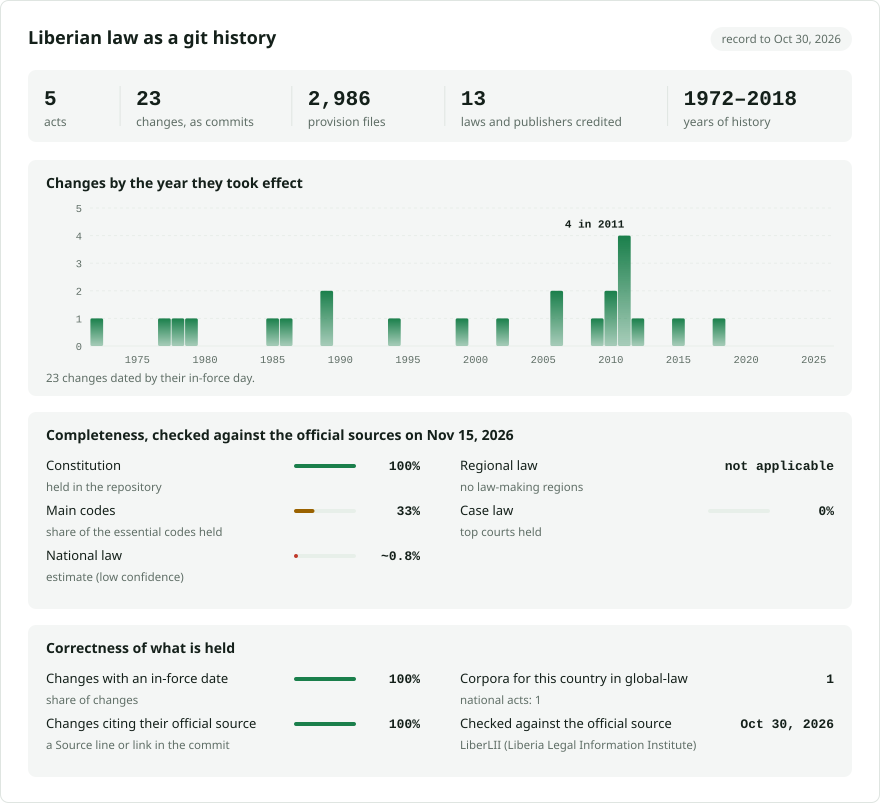

# Liberia: law history in git

<picture>
<source media="(prefers-color-scheme: dark)" srcset="data/effort-dark.svg">

</picture>


The law of Liberia as a git history: one file per article or section, one commit per version on the day it took effect, and the law that made each change as the commit's author. `git blame` names the law behind every paragraph; `git log` lists every change to a provision; picking a date gives the text in force that day.

Part of [lexifina/global-law](https://github.com/lexifina/global-law), one git history for every country's law: this is Liberia's national law, which global-law reads at `liberia/national/acts/`.

**What is in it now:** the Constitution of 1986; titles of the Liberian Code of Laws Revised (Civil Procedure, Associations, Commercial Code, Decedents Estates, Domestic Relations, General Construction, Penal Law, Public Health); separate Acts from 1972 to 2026 (`acts/`); regulations, rules and directives of the Central Bank, the Liberia Revenue Authority, the Forestry Development Authority, regulators and ministries (`regulations/`); Executive Orders and a proclamation. Category totals and how each was dated are in [`REPRODUCE.md`](REPRODUCE.md). See [`STRUCTURE.md`](STRUCTURE.md) for the layout. Supreme Court decisions are kept in a separate case-law repository. [`REPRODUCE.md`](REPRODUCE.md) says how each part was built; [`data/laws.csv`](data/laws.csv) lists the 6 laws the first build named, with their dates.

Titles of the Code are in `codes/title-NN-<slug>/`, separate Acts in `acts/<year>/<slug>/`, regulations in `regulations/<year>/<slug>/`, Executive Orders in `executive-orders/<year>/<NNN>-<slug>/`, each with one file per article or section named by its printed number and a `README.md` listing its provisions (`codes/title-26-penal-law/sec-14-070.md` is § 14.70 of the Penal Law, on rape; `constitution/art-083.md` is Article 83 of the Constitution).

The text is in English, as each source prints it; its contents lists are left out, and its dated notes are in the commit messages.

## Questions as git commands

| Question | Command |
| --- | --- |
| Every change to § 14.70 of the Penal Law | `git log -p --word-diff -- codes/title-26-penal-law/sec-14-070.md` |
| Which law wrote each line of § 14.70? | `git blame codes/title-26-penal-law/sec-14-070.md` |
| Every version of the Penal Law, with the day each took effect | `git log --format="%h %(trailers:key=In-force,valueonly,separator=) %an" -- codes/title-26-penal-law ':!codes/title-26-penal-law/README.md'` |
| § 14.70 as in force on 1 January 2000 | `python tools/on.py 2000-01-01 codes/title-26-penal-law sec-14-070` |

**Outside git**, we also host this record publicly, for free:

- **[Ask Claude about Liberian law](https://global-law.lexifina.com/v1/try_claude?country=liberia)**: opens Claude with a first question ready.
- **[Ask ChatGPT](https://global-law.lexifina.com/v1/try_chatgpt?country=liberia)**: the same question in ChatGPT.
- **[Search Liberian law on our site](https://lexifina.com/law?country=liberia&q=theft)**: a search for "theft", with each provision's text and its versions, no account needed.
- **[Developer REST API](https://global-law.lexifina.com/v1/search_law?query=theft&jurisdiction=liberia)**: the same search as JSON, with no key. See the [documentation here](https://lexifina.com/api/global-law).

Both assistants read the record through the free Global law connector (MCP, `https://global-law.lexifina.com/mcp`); the first time, the chat gives you the link that adds it. Ask in English.

**Host it yourself easily.** All it takes is git and Python, and the tools run on your machine:

```sh
git clone --depth 1 https://github.com/lexifina/global-law && cd global-law
python3 tools/countries.py add liberia/national/acts
python3 tools/law.py show 2026-01-01 liberia/national/acts/codes/title-26-penal-law/sec-14-070.md
```

Opened in Claude Code, Cursor, VS Code or Codex, the clone also starts a local MCP server with the same tools ([MCP.md](https://github.com/lexifina/global-law/blob/main/MCP.md)).

## Dates

Each commit is dated at noon, Africa/Monrovia (UTC), on the day the version took effect, and carries it in its `In-force:` trailer. No general rule on when a statute takes effect was found (LiberLII's General Construction Law, Title 15, has none), so each day comes from the act itself or from LiberLII's notes:

- for an act's first version, its own in-force clause: the Penal Law (3 April 1978), the Freedom of Information Act (6 October 2010) and the Commercial Code (7 October 2010) take effect on publication, on the day the text prints; the Associations Law is headed "Effective: January 3, 1977";
- for the Constitution, 6 January 1986, the entry into force WIPO Lex gives (it was adopted by referendum on 3 July 1984);
- for a later change, LiberLII's own dated note or footnote ("Effective December 6, 1994"); where it does not give the earlier wording, the provision reads "[The source does not give the text in force on this date.]" before that day.

Each change is credited to the law that made it where LiberLII names one: the Constitution, the Freedom of Information Act and the Commercial Code as enacted, and the Interim National Assembly's amendment of § 12.51 in 1985. The other six changes are committed by the publisher (`LiberLII`) and labelled unexplained. The first version of the Penal Law and of the Associations Law is the "oldest version available", credited to LiberLII and naming the 1976 law it comes from, because LiberLII's text already includes later changes.

## How it is checked

- `tools/check_repo.py` reads every version back from git on the day it took effect and on the day before, and compares it with the corpus: 12 versions of 5 acts, 0 mismatches (see [`REPRODUCE.md`](REPRODUCE.md)).
- Each act's latest text was checked word for word against the LiberLII page it was parsed from: no word is added, and every word of the page is in the history or in a left-out outline, title line or note.
- A second build from the same corpus gave identical hashes for all 12 history commits and 16 tags.
- History is append-only: no merge commits, no commit date that goes backwards, none dated in the future, and every commit's trailers parse.
- [vulnerabilities/](vulnerabilities/): possible drafting mistakes in this law, found by global-law's detectors and checked by hand. Not run yet.

## What it does not show

- **Constitutional amendments.** Those put to the referendums of 2011 (Joint Resolution 001 of 2010, on Articles 52(c), 72(b) and 83(a) and (b)) and 2020 are not applied: LiberLII prints the 1986 text, and no source with a text layer gives the amended wording. `constitution/art-083.md` may not be the wording in force today.
- **Undated amendments.** LiberLII consolidates some amendments without a note; those provisions are shown in every version as it prints them, so an older version may hold later wording. Amendments LiberLII has not applied are not shown at all.
- **The earlier rape provisions.** The § 14.70 and § 14.71 in force before 17 January 2006 still govern earlier offences; the files show the text for new ones. § 14.78(3) and (4), repealed by the new § 14.70, are kept as LiberLII prints them.
- **Which law made most changes.** LiberLII names no amending law for six of the seven changes after a first version.
- **Most Liberian law.** Government sites publish many acts as scanned PDFs without a text layer, which are not read (no OCR of ours). The Criminal Procedure Law (Title 2) is not built: no source found gives its text with a date. Titles taken from the Liberia Land Authority's laws repository without an effective date (Civil Procedure, Domestic Relations, General Construction, Public Health) are dated as at the day the publisher's PDF was made (`In-force-basis: publisher-file-date`), so their history starts on that day; the Domestic Relations Law's publication day in 1973 is not printed in the copy. Copies that are not the official handbill are tagged `Source-status: secondary copy`.

## Sources

| Source | Kind | Past versions | Notes |
| --- | --- | --- | --- |
| [LiberLII](https://www.liberlii.org) (Liberia Legal Information Institute, WorldLII) | Legal information institute: titles of the Liberian Code of Laws Revised and acts | no; one text per act, with dated notes | The text, the in-force clauses, and the dated notes behind each later version; read from pinned [Internet Archive](https://web.archive.org) captures |
| [WIPO Lex](https://www.wipo.int/wipolex/en/legislation/details/8556) | Legislation database | no | The Constitution's adoption and entry into force |
| National Elections Commission, Referendum Regulations (2011) | Regulations | no | Joint Resolution 001 (2010), the amendments put to the 2011 referendum |
| [Liberia Land Authority laws repository](https://lla.gov.lr/index.php/downloadable-resources/policies-laws-regulations-repository) | Government agency's library of Acts, handbills and Code titles (PDF) | no | Text from the PDFs' own text layers; dates from the handbill covers and in-force clauses |
| [Ministry of Labour](https://mol.gov.lr) | Ministry site (PDF) | no | The Decent Work Act 2015 handbill |

## Licence

See [`LICENSE`](LICENSE). LiberLII publishes no licence for its legislation pages, and the Liberia Land Authority and the Ministry of Labour publish their PDFs without terms; they are the public law of Liberia, reproduced with attribution, and neither LiberLII nor the Government of Liberia endorses this repository. Lexifina's arrangement, commit messages, tables and tools are CC0 1.0.

No AI model wrote, translated or corrected legal text, and none runs at build time; the scripts were written by an AI model (see [`REPRODUCE.md`](REPRODUCE.md)).

## Visualisations

- [visualisations/](visualisations/): charts drawn from this repository. Not drawn yet.

## More

From [lexifina/global-law](https://github.com/lexifina/global-law):

- [FEATURES.md](https://github.com/lexifina/global-law/blob/main/FEATURES.md): every feature, and what every corpus must support (`git blame`, `law.py`, the MCP tools)
- [FAQ.md](https://github.com/lexifina/global-law/blob/main/FAQ.md): questions and answers · [CONTRIBUTING.md](https://github.com/lexifina/global-law/blob/main/CONTRIBUTING.md): proposing changes · [MCP.md](https://github.com/lexifina/global-law/blob/main/MCP.md): the MCP server · [REPRODUCE.md](https://github.com/lexifina/global-law/blob/main/REPRODUCE.md): how it was built · [CHANGELOG.md](https://github.com/lexifina/global-law/blob/main/CHANGELOG.md)
- [FRESHNESS.md](https://github.com/lexifina/global-law/blob/main/FRESHNESS.md): how current each corpus is · [Monitoring](https://github.com/lexifina/global-law/tree/main/monitoring): whether updates are running · [WATCHING.md](https://github.com/lexifina/global-law/blob/main/WATCHING.md): how each official source is watched for changes
- [performance/](https://github.com/lexifina/global-law/tree/main/performance): how fast the tools are, measured
- [visualisations/](https://github.com/lexifina/global-law/tree/main/visualisations): charts and bridges across the world's law
- [Vulnerabilities](https://github.com/lexifina/global-law/tree/main/vulnerabilities): mistakes in legislation as published
